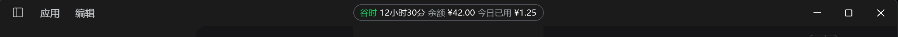
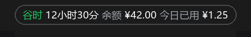
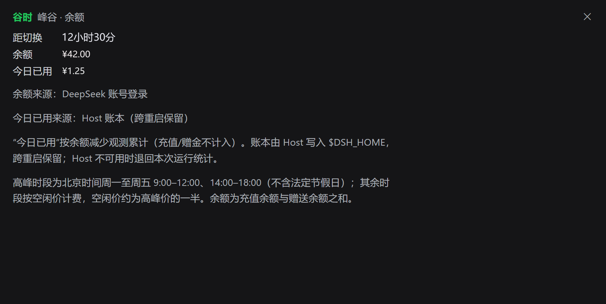

# dsh-peak-bar

**简体中文** | [English](README.en.md)

> ⚠️ **测试版（pre-release）** —— 版本号仍是 `0.x`，CSS 变量名与文件结构可能变动；接口未冻结。

**在窗口标题栏正中放一枚小胶囊：DeepSeek API 的峰谷时段、距下次切换的倒计时、账户余额、今日已用。**

一个 DSH（DeepSeek Harness）插件。点胶囊在主区域打开详情面板；读取失败时不静默——
把原因写在胶囊上。颜色**默认跟随当前皮肤**，也可以逐项覆盖。

> **样式表里没有任何颜色字面值。** 每个颜色变量的默认值都是宿主的语义 token
> （`--dsw-alias-*`），所以它自动取当前皮肤的配色、深浅两套值与强调色。
> 想自定义只覆盖需要的那几个变量，其余继续跟皮肤走。
> 这一点有回归测试钉住，不存在「某个皮肤下颜色跑偏」的情况。

---

## 外观与位置





胶囊显示当前是高峰还是空闲、距下次切换的倒计时，以及账户余额。倒计时**剩余超过一小时时只到分钟**（形如 `59小时24分`），**最后一小时内才精确到秒**（形如 `18分57秒`）。点击胶囊会在主区域打开详情面板，面板里是峰谷状态、距下次切换的倒计时、余额、今日已用和计费规则说明，
**右上角的 `✕` 可以退回对话**。



> 图中金额、倒计时是**示意数值**（真实余额与消费已替换），其余内容为原样。

胶囊落在窗口标题栏正中央，在 Windows 上和最小化/关闭按钮同一行、位于它们左侧（不重叠、不遮挡）。
上面那张图就是实机截图（屏幕 150% 缩放、2115px 宽），量得胶囊中心在 **49.9%** 处。

**为什么用标题栏**：DSH 的窗口 chrome 座位 `shell.leading` 只在 macOS + 侧栏收起时才挂载，
Windows 上没有标题栏槽位。本插件注册进 `shell.overlay`——根帧的覆盖层，`inset:0`
覆盖包含标题栏的 padding box——因此 Windows 上也能落在标题栏这一行。
座位用 `left:50%` + `translateX(-50%)` 表达居中；精确落点由 shell 给的覆盖层盒子决定，
想自己钉住见下面[「位置」](#位置)一节。

胶囊是 `position:absolute`，座位 `pointer-events:none`，只有胶囊本身可点，
并设了 `-webkit-app-region:no-drag`，所以标题栏其余部分仍然可以拖动窗口。

### 读取失败时

- **还没读到过任何数值**时，胶囊写一句短原因（「余额读取失败」）——一个光秃秃的 `--` 必须带解释。
- **已经有数值**时保留上次的数字，只有失败**持续超过 2 分钟**才挂一个两字标记「余额未刷新」。
  平台把瞬时抖动也报成 `status=failed`，而这种抖动一天里会反复出现，所以宽限按分钟计。
- **未配置 API key** 时只说「未配置 API key」——这是配置事实，不是错误。

**完整原因始终在悬停提示与详情面板里**（例如「账号未就绪（status=failed）」「账号 Remote 不可用」）。
胶囊本来就窄，平台原因动辄几十个字，写上去会把胶囊撑出窗口边缘被截断，所以那里只放短句。

失败期间重试节奏是 **15 秒 → 30 秒 → 60 秒**递退（正常间隔 60 秒），既能在短暂抖动后迅速修好，
也不会长时间高频敲平台；浏览器报告网络恢复（`online`）或窗口重新可见时**立刻重试**，
所以断网恢复后几秒内就会自愈。

---

## 安装

三种入口任选一种，装完之后按[「重启」](#重启刷新页面不够)一节操作。

### 1. 从 GitHub 克隆

```bash
git clone https://github.com/Woo3aN/dsh-peak-bar.git
cd dsh-peak-bar
npm test          # 可选：三套离线测试，不需要 DSH 运行时
```

然后按下面的「添加本地目录」，填入克隆下来的目录绝对路径。

### 2. 解压即用（Release 附件）

到 [Releases](https://github.com/Woo3aN/dsh-peak-bar/releases) 下载
`dsh-peak-bar-<版本>.zip`，解压得到 `dsh-peak-bar/` 目录，再按「添加本地目录」指过去。
同一个 Release 里还有 `dsh-peak-bar-<版本>.tgz`，可直接走「添加打包后的 tgz」那条路。

### 3. 桌面端：添加本地目录

插件 → 添加插件 → 填入本目录的绝对路径。

### 4. 桌面端：添加打包后的 tgz

插件 → 添加插件 → 填入打包后 tgz 的绝对路径。
（自己打包：`npm pack`，产物为 `dsh-peak-bar-<版本>.tgz`。）

### 5. 命令行

```bash
dsh plugin --profile web add "<本目录绝对路径或包名>"
```

### 重启：刷新页面不够

- 改 Host 半（`index.js`）**必须整进程重启 DSH**。
- 只改 `client.js` 也要重启才能换：Host 在插件激活时把客户端产物快照进内存。

---

## 峰谷规则

| 时段 | 计费 |
|------|------|
| 北京时间周一至周五 09:00–12:00、14:00–18:00 | 高峰价 |
| 其余时段 | 空闲价，约为高峰价的一半 |
| 法定节假日 | 全天按空闲价 |

倒计时**剩余超过一小时时只到分钟**，最后一小时内精确到秒。节假日表的覆盖范围见[「已知限制」](#已知限制)。

---

## 数据来源与隐私

余额有**两条路**，按顺序尝试：

| 顺序 | 路径 | 取数方式 |
|------|------|----------|
| ① | **账号登录态** | `ctx.remote.account.getBalance()`，和 DSH 自带「账号与余额」设置卡片同一条路 |
| ② | **API key** | 账号路拿不到时，问 Host 半的 `/dsh-peak-bar/balance` |

**关于 ① 的返回结构**：它是两层的 `{ok, value}`，其中 `value` 是
`{status, value: 充值钱包[], bonusWallets: 赠金钱包[]}`。余额 = 充值 + 赠金，
多币种分别显示，并用 ` + ` 连接。

**关于 ②**：Host 从 DSH 凭据服务解析 `DEEPSEEK_API_KEY`，
直连官方 `GET https://api.deepseek.com/user/balance`，只回传 `total_balance` 与币种。
**密钥不出 Host、也不会发给除官方端点以外的任何地方。**

两条路口径一致（都是充值 + 赠金），所以「今日已用」的差额记账在切路时仍然正确。
面板里会写明这次余额来自哪条路（`余额来源：DeepSeek 账号登录 / API key`）。

**不把任何数据发往第三方。** 账号余额走 DSH 自己的账号服务，API key 余额只发往 DeepSeek 官方端点。

---

## 今日已用

账号接口给的是**余额**，不是账单，所以「今日已用」是按**余额下降**观测累计出来的：

- 两次读取之间余额下降的差额算消费
- 余额上升（充值 / 赠金）**不计入**，也不会把已记的消费抹掉
- 按**北京时间日**分账，和官方计费日一致

账本由 **Host 半**写在 `<DSH_HOME>/.dsh-peak-bar.json`（默认 `~/.dsh/`）。
放 Host 而不是放页面里，是因为桌面端每次启动的端口可能不同——端口一变，页面 origin 就变，
`localStorage` 会被清空。文件里只保留最近 **14 天**的日汇总，写入是原子的（临时文件 + rename），
文件损坏时当作空账本继续，不会影响插件运行。

Host 路由不可用时（例如没有 HTTP 载体的 profile），胶囊退回「本次运行统计」，
并继续正常显示峰谷与余额——**丢的是历史，不是功能**。

**显示口径**：胶囊里两个数字都带标签、都不带符号 —— 形如
`谷时 18分57秒 余额 ¥20.79 今日已用 ¥0.20`，今日已用是两位小数
（过小不足以显示两位时是 `<0.01`）；当日还没有消费时不显示「今日已用」那一段。

---

## 语言

插件**没有自己的语言开关**，它跟随 DSH 的界面语言，切一次胶囊和面板一起变：

> DSH **设置 → 通用 → 语言** → `中文` / `English`

实现上，胶囊与面板的可见文字都走 `ctx.locale`（词典注册在插件自己的命名空间下），
`zh` 与 `en` 两套键齐全且互为对照，`zh` 的回退链是 `en`，所以 DSH 支持的语种里
不会有一套落到「直接显示键名」。切换**不需要重装、也不需要重启**：
`t` 由宿主的 `getSnapshot` / `subscribe` 支撑，而且胶囊本身每秒重绘一次。

插件卡片上的标题与描述来自 `locale/zh.json` / `locale/en.json`。

## 跟随主题与皮肤

**跟随是默认行为，不需要任何配置。** 胶囊的每个颜色变量的默认值都指向宿主的语义 token
（`--dsw-alias-*`），所以它自动取当前皮肤的配色、深浅两套值与强调色；
动效时长用主题的 `--ds-transition-duration` / `--ds-ease-in-out`，
焦点环用宿主的 `--dsw-focus-ring-*`，系统开启「减少动态效果」时过渡自动关闭。

自定义是叠在其上的一层，不是替代：覆盖任意几个变量即可，其余继续跟皮肤走。

## 自定义颜色

本插件**不声明** `--dsh-peak-bar-*` 自身，只在用到的地方写成
`var(--dsh-peak-bar-x, 主题 token)`。这一点是刻意的：主题把 `--dsw-alias-*` 以内联变量挂在
**`body`** 上，若把 `--dsh-peak-bar-x` 声明在 `html` 上，它就会在「那些 token 还不存在」的元素上
求值而变成非法值——边框这种没有 fallback 的属性会直接消失（早期版本正是这样丢掉描边的）。
写在使用处则由那枚按钮求值，能看见 body 上的 token。

也正因我们不声明任何变量，**任何覆盖都直接生效**：皮肤的 `skin.css`、自定义样式表、
`:root`、`body`、胶囊元素本身，都不必和本文件比优先级。

| 变量 | 作用 | 默认值 |
|------|------|--------|
| `--dsh-peak-bar-bg` | 胶囊底色 | `var(--dsw-alias-button-elevated-fill, transparent)` |
| `--dsh-peak-bar-bg-hover` | 悬停底色 | `var(--dsw-alias-button-floating-hover)` |
| `--dsh-peak-bar-border` | 描边 | `var(--dsw-alias-border-l2)` |
| `--dsh-peak-bar-text` | 金额等主文字 | `var(--dsw-alias-label-primary)` |
| `--dsh-peak-bar-offpeak` | 「谷时」标签（取主题的成功色，即绿色） | `var(--dsw-alias-state-success-primary, var(--dsw-alias-label-secondary))` |
| `--dsh-peak-bar-peak` | 「高峰」标签 | `var(--dsw-alias-brand-primary)` |
| `--dsh-peak-bar-countdown` | 倒计时数字 | `var(--dsw-alias-label-tertiary)` |
| `--dsh-peak-bar-label` | 「余额 / 今日已用」标签 | `var(--dsw-alias-label-tertiary)` |
| `--dsh-peak-bar-spent` | 今日已用金额 | `var(--dsw-alias-label-secondary)` |
| `--dsh-peak-bar-note` | 失败原因文字 | `var(--dsw-alias-label-tertiary)` |
| `--dsh-peak-bar-radius` | 圆角 | `999px` |
| `--dsh-peak-bar-font-size` | 字号 | `12px` |

### 皮肤作者接入

皮肤想接管胶囊外观时，只覆盖差异部分即可 —— 下面这段让胶囊改用皮肤自己的侧栏底色、
直角风格与品牌强调色：

```css
/* 你的 skin.css */
:root {
  /* 底色跟着标题栏那条带子走，而不是用一个泛化的浮起色 */
  --dsh-peak-bar-bg: var(--dsw-specific-sidebar-fill, transparent);
  --dsh-peak-bar-border: var(--dsw-alias-border-l3);
  /* 直角皮肤：胶囊也切成直角。圆角档位不是每个皮肤都定义，
     所以给一个字面量兜底 —— 只写 var(--dsw-radius-sm) 的话，
     皮肤没定义这个 token 时整条声明会变成非法值而失效。 */
  --dsh-peak-bar-radius: var(--dsw-radius-sm, 4px);
  /* 强调色仍是皮肤的品牌色，只是换个 token */
  --dsh-peak-bar-peak: var(--dsw-alias-brand-primary);
}
```

只改几个变量时不必写全表：没提到的继续跟随皮肤。
**引用皮肤 token 时一律带字面量兜底**（`var(--dsw-xxx, 兜底值)`）——
莱茵生命皮肤里就有若干 token（例如 `--dsw-radius-*`）并未定义。

### 示例

| 主题 | 预览 |
|------|------|
| 莱茵生命默认橙 | 深棕底 + 橙描边，高峰标签用亮橙 |
| 纯灰高对比 | 纯黑底 + 白描边，无彩度 |
| 冷色青 | 深青底 + 青色强调 |

```css
/* 一、莱茵生命默认橙 */
:root {
  --dsh-peak-bar-bg: #2a1a10cc;
  --dsh-peak-bar-border: #ff8a3d55;
  --dsh-peak-bar-peak: #ff9d4d;
  --dsh-peak-bar-text: #ffe9d2;
}

/* 二、纯灰高对比 */
:root {
  --dsh-peak-bar-bg: #101010;
  --dsh-peak-bar-border: #ffffff;
  --dsh-peak-bar-text: #ffffff;
  --dsh-peak-bar-radius: 6px;
}

/* 三、冷色青 */
:root {
  --dsh-peak-bar-bg: #06222a;
  --dsh-peak-bar-border: #1de9b644;
  --dsh-peak-bar-peak: #35e0d0;
  --dsh-peak-bar-countdown: #7fd7d0;
}
```

## 位置

胶囊的落点由 shell 的 `shell.overlay` 覆盖层决定（见上面[「外观与位置」](#外观与位置)里的实测说明）。
想自己钉住位置，就覆盖座位类的定位——**注意类名不是公开契约，改版可能变，请自行验证**：

```css
/* 真·整窗居中：position:fixed 的包含块是视口，不受覆盖层盒子影响 */
.dshPeakBarSeat { position: fixed; left: 50%; right: auto; transform: translateX(-50%) }

/* 或者紧贴窗口按钮左侧：132px ≈ 100% 缩放下的三枚按钮宽度，缩放后会变 */
.dshPeakBarSeat { position: absolute; left: auto; right: 132px; transform: none }
```

---

## 目录结构

```
dsh-peak-bar/
├── index.js              ★ Host 半：本机路由 + 原子写账本 + API key 余额路
├── client.js             ★ Client 半：胶囊、详情面板、词典、样式
├── cordis.patch.yml      注册进 profile 的 bundle patch
├── package.json          清单（dsh.bundle / dsh.client 声明）
├── icon.svg              插件图标
├── locale/
│   ├── zh.json           插件卡片元数据（中文）
│   └── en.json           插件卡片元数据（英文）
├── docs/                 实机截图（README 引用）
├── tests/
│   ├── peak.test.mjs     峰谷规则，7 项
│   ├── render.test.mjs   渲染 / 注入 / 主题默认值 / 点击 / 账本往返（离线，替身 React）
│   └── host.test.mjs     Host 账本（记法、校验、信任栅栏、损坏文件），28 项
├── .github/workflows/
│   ├── test.yml          三平台 × Node 20/22 跑测试
│   └── release.yml       推 tag 自动打包 zip + tgz 挂到 Release
├── README.md / README.en.md
├── CHANGELOG.md
└── LICENSE               MIT
```

## 自检

```bash
npm test
```

三套测试全部**离线**跑：`render` 用替身 React 与替身模块加载器，
`host` 用临时 `DSH_HOME`——都不碰你真实的 `~/.dsh`。

`.github/workflows/test.yml` 会在 **ubuntu + windows + macos × Node 20/22** 上自动跑这套测试。

---

## 已知限制

- 账号路与 API key 路**都不可用**时才会显示失败原因（例如既没登录账号、凭据里也没有
  `DEEPSEEK_API_KEY`）；面板会同时列出两条路各自的原因。
- 账户读取由 Host 侧完成，插件按 **60 秒**轮询；页面重新可见时会立即刷新一次。
- **法定节假日表只覆盖 2026 年**（来源：国务院办公厅关于 2026 年部分节假日安排的通知）；
  2027 年起需要补表，否则节假日会被算成高峰。超出覆盖范围时面板会提示判定可能不准。
- 只在 **Windows 官方桌面客户端 + DSH 0.2.0-rc.2** 实测过；macOS/Linux 与纯浏览器模式未测。
  纯浏览器模式下没有标题栏，胶囊会浮在应用顶部居中。
- 请求里带的客户端版本是 `'unknown'`：DSH 官方客户端在构建时内联 `DSH_CLIENT_VERSION`，
  第三方插件拿不到，只能兜底（实测可用）。
- 「今日已用」是按余额差观测的**推算值**，不是平台账单：它看不到余额之外的花费
  （例如赠金消耗与充值在观测口径下会互相抵消的部分），也不含其他厂商渠道的消费；
  「余额上升」一律视为充值、不计为负消费。
- 该账本只在本机写文件，不联网；Host 路由不可用时退化为「本次运行统计」。

---

## 设计取向

- **跟随优先，覆盖可选。** 默认值全部指向宿主语义 token，插件不发明自己的配色体系；
  自定义是叠在其上的一层，不是替代。
- **失败要说话。** 宁可挂一个短标记，也不静默显示 `--`；但短标记只占两个字，
  完整原因放去有空间的地方。
- **状态放 Host，页面只负责显示。** 端口会变、origin 会变，`localStorage` 靠不住。
- **凭据不出 Host。** API key 只在本机进程内解析、只发给官方端点。

## 贡献

欢迎提 Issue / PR。特别欢迎两类：**在你自己的皮肤下发现的配色问题**，
以及**新的节假日表**（每年国务院办公厅发文后）。

## 致谢

这个插件的做法直接受益于以下项目与实现：

| 项目 | 借鉴之处 |
|------|----------|
| [dsh-whale-widget](https://github.com/MeteorNOX/DeepSeek-Balance-Whale-Widget)（MeteorNOX） | 「Host 持有凭据与账本、客户端只负责显示」这套分工；「今日已用 = 余额下降观测累计」的记账口径；API key 余额这条路的思路 |
| [dsh-plugin-rhine-lab-theme](https://github.com/Galaxy-2001/Rhine-Lab-Codex-Theme)（Galaxy-2001） | 「跟随皮肤」的判据（语义 token 与深浅两套值）以它定义的为准；本插件就是在该皮肤下开发与验证的 |
| DSH 自带的「账号与余额」设置卡片（`@deepseek-ai/dsh-client-ui-settings-account`） | 余额的读取路径、返回结构（外层 `{ok, value}`、内层 `{status, value, bonusWallets}`），以及「`remote.account` 是独立于 `remote` 的服务名」这一点 |

本插件不打包任何第三方代码或美术素材：`icon.svg` 为本项目自有。

## License

MIT © Woo3aN —— 见 [LICENSE](LICENSE)。
